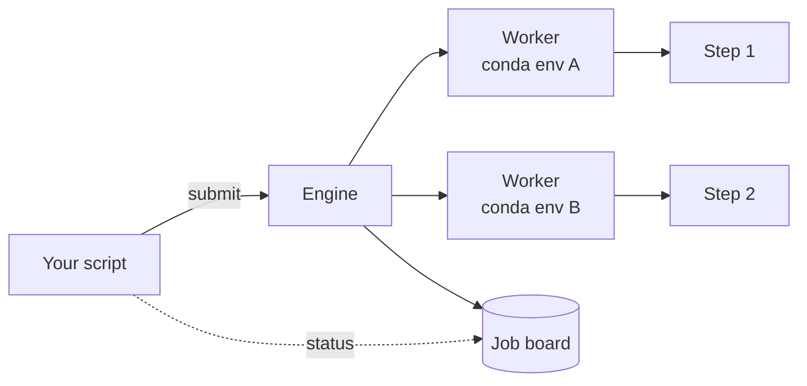

# 1. Use the engine

This page shows how to run an analysis with the ZMART Analysis engine. For
a guided first run, open the [tutorial notebook](tutorial.ipynb).

## How it works

You make an engine, register a pipeline, submit images and read their output
from the job board. Each section below is one of these steps, in that order.

Three words come back throughout:

- A **pipeline** is a YAML file. It lists the steps of an analysis, in order,
  with their parameters.
- A **step** is one Python file with one function, `run`.
- A **worker** is a Python process that runs a step, in the conda
  environment the step asks for.



The engine never runs a step itself. It hands each job to a worker. A
worker starts the first time it is needed and then stays running for as long
as a pipeline that needs it is registered, so a model loaded for the first
image is ready for the next one.

The conda environments must exist before the first run. Each workflow has a
script that makes them; see [Install it](../../README.md#install-it).

<br>

## Make an engine

```python
engine = Engine()
```

| Argument | Default | Meaning |
|---|---|---|
| `max_concurrent` | `8` | How many jobs run at the same time. |
| `execution_timeout` | `300.0` | Seconds one step may run before it is stopped and its job fails. `None` means no limit. |

Workers are not stopped while they wait. A worker stops only when you
deregister the last pipeline that needs it, or shut the engine down.

`with Engine() as engine:` shuts the engine down when the block ends.

<br>

## Register a pipeline

```python
engine.register("my_pipeline", "path/to/my_pipeline.yaml", "path/to/run")
```

`register(name, yaml_path, output)` reads the pipeline and checks that every
step file exists and names its environment. No step code runs yet and no
worker starts. You choose the `name`, and every later call uses it.
Registering the same name twice raises `ValueError`; deregister it first.

The pipeline writes everything into `<output>/analysis/<name>/`:

```
analysis/
    my_pipeline/
        pipeline.yaml     a copy of the pipeline you registered
        run.jsonl         the run record
        ...               the files the steps keep
```

The run record has one line per event: the registration, every submit
(with the data, so the files that were processed), the end of every job
(with where and with which packages each step ran, and the error if it
failed), and the deregistration. Each line is written the moment it
happens, so you can read the record during the run, and it survives a
crash. Registering the same name again adds to the same record.

A pipeline looks like this:

```yaml
metadata:
  purpose: "Focus scoring for a z-stack"
  version: "1.0"
  functions_dir: "../steps"
  verbose: 1

focus:
  - score_focus:
      metric: brenner
      skip_ends: 2
```

The `metadata` block describes the pipeline:

| Key | Meaning |
|---|---|
| `purpose`, `version` | Notes for the reader. |
| `functions_dir` | The folder with the step files, relative to the pipeline. Default `../steps`. |
| `verbose` | `0` is silent. Above that, the steps print progress. Default `2`. |
| `levels` | Only for pipelines with scoped steps. See [Steps that wait for a group of images](#steps-that-wait-for-a-group-of-images). |

The other top-level key, here `focus`, holds the steps in the order they
run. A step is named after its file: `score_focus` is `score_focus.py`.

Everything under a step is a parameter for that step, except two keys that
the engine reads itself:

| Key | Meaning |
|---|---|
| `scope` | Run this step once per group of images, not once per image. |
| `max_workers` | How many copies of this step may run at once. This overrides the value in the step file. |

A pipeline cannot choose a step's conda environment. The step file must name it
([part 2](../2_implement_an_analysis_step/README.md#metadata)).

## Submit images

```python
# Submit three positions of group 1; each submit returns a job id
job_1 = engine.submit(
    pipeline="my_pipeline",
    data={"image_path": "image1.tif"},
    scope={"carrier": 1, "compartment": 1, "group": 1, "position": 1},
    complete=None,
)

job_2 = engine.submit(
    pipeline="my_pipeline",
    data={"image_path": "image2.tif"},
    scope={"carrier": 1, "compartment": 1, "group": 1, "position": 2},
    complete=None,
)

# The last position of the group says the group is complete
job_3 = engine.submit(
    pipeline="my_pipeline",
    data={"image_path": "image3.tif"},
    scope={"carrier": 1, "compartment": 1, "group": 1, "position": 3},
    complete="group",
)
```

`submit(pipeline, data, scope=None, priority=None, complete=None)` hands one
image to a pipeline. It returns the job's id at once; the work happens in the
background. Ids are whole numbers, counted per pipeline from 1.

Each image names its carrier, compartment, group and position. The last
image of the group says that the group is complete.

| Argument | Meaning |
|---|---|
| `pipeline` | The name you registered the pipeline under. |
| `data` | A dictionary with the input for this job. The pipeline decides what belongs in it; the comment at the top of a shipped pipeline says what to submit. |
| `priority` | A whole number. Higher runs first. Jobs with the same priority run in the order they were submitted. Default `0`. |
| `scope`, `complete` | Only for pipelines with scoped steps. See [Steps that wait for a group of images](#steps-that-wait-for-a-group-of-images). |

Submitting to a name that is not registered raises `KeyError`. Submitting
after `shutdown` raises `RuntimeError`.

The first job of a step starts its worker. That job waits while the worker
starts; the jobs after it do not.

## The job board

```python
print(engine.status("my_pipeline"))
```
```
{1: {'step': 'segment',
     'scope': {'carrier': 1, 'compartment': 1, 'group': 1, 'position': 1},
     'state': 'done', 'output': {...}},
 2: {'step': 'segment',
     'scope': {'carrier': 1, 'compartment': 1, 'group': 1, 'position': 2},
     'state': 'running', 'output': None},
 3: {'step': 'segment',
     'scope': {'carrier': 1, 'compartment': 1, 'group': 1, 'position': 3},
     'state': 'queued', 'output': None},
 4: {'step': 'summarise',
     'scope': {'carrier': 1, 'compartment': 1, 'group': 1},
     'state': 'waiting', 'output': None}}
```

`status(name)` is the job board of a pipeline: every job it has had, by id.
You poll it to see how far your jobs are and to read their output.

Jobs 1 to 3 run `segment` on each image. Job 4 is the group step: the
pipeline runs `summarise` once per group, so its scope stops at the group. It
waits until the three positions are done, then runs on their outputs.

| Key | What it is |
|---|---|
| `step` | The step the job is at, or the last one it ran. |
| `scope` | The unit the job runs over. `{}` for a pipeline without scopes. |
| `state` | `queued`, `running`, `waiting`, `done`, `failed` or `cancelled`. |
| `output` | What the steps returned, once the job is `done`. `None` before. |
| `error` | Only on a `failed` job: what went wrong. |

The states:

| State | Meaning |
|---|---|
| `queued` | Submitted, not started. |
| `running` | A step is running. |
| `waiting` | A scoped job waits for the images of its unit to finish. |
| `done` | Finished. The output is there. |
| `failed` | A step raised an error. |
| `cancelled` | Stopped by `deregister` or `shutdown` before it finished. |

`status()` without a name gives one board per pipeline, keyed by the pipeline's
name. Each pipeline counts its own ids, so two pipelines can both have a job 1.

The board keeps every job and its output until you deregister the pipeline or
shut the engine down. `deregister` hands you the final board.

### The output

The output of a job is a dictionary:

| Key | What it is |
|---|---|
| the step's name | What that step produced. There is one key per step. |
| `input` | What you submitted. |
| `metadata` | The pipeline's name and file, the steps that ran, the `scope` and the time. |
| `provenance` | Where each step ran: the `environment`, the `python` version, the versions of the `packages` it imported, and a `fingerprint` of everything installed. Two outputs with the same fingerprint ran in identical environments. |

## Steps that wait for a group of images

Some steps cannot run on a single image. A summary of a well needs every
image of that well. Such a step gets a `scope` in the pipeline. It waits
until you say the group is complete, and then runs once on all their outputs.

Two more words:

- A **level** is a way to group images, such as `compartment` or `carrier`.
  You choose the names.
- A **unit** is one such group, such as compartment 3 of carrier 1.

The shipped pipelines use four levels, widest first. The *experiment* holds
everything. A *carrier* is a plate or a slide. A *compartment* is a well, a
region of a slide, or part of a cleared sample. A *group* is a set of
images within a compartment. Each image is one *position*.

### In the pipeline

```yaml
metadata:
  functions_dir: "../steps"
  levels: [experiment, carrier, compartment, group]   # widest first

object_analysis:
  - detect_objects:               # every image, as soon as it arrives
  - extract_classical_features:
  - build_object_table:
  - summarise_population:         # once per compartment
      scope: compartment
  - compare_populations:          # once per carrier
      scope: carrier
```

Steps before the first `scope` run on every image. A step with a `scope`
runs once per unit of that level. The steps after it, up to the next
`scope`, run with it on the same unit.

A scoped step works on the outputs of the level below. Here
`summarise_population` receives one output per image, and
`compare_populations` receives one output per compartment.

### In your script

Every image says which units it belongs to. The last image of a unit says
that the unit is complete:

```python
engine.submit(
    pipeline="analysis",
    data=image,
    scope={"carrier": 1, "compartment": 3, "group": 1, "position": 1},
    complete=None,
)
engine.submit(
    pipeline="analysis",
    data=last_image,
    scope={"carrier": 1, "compartment": 3, "group": 1, "position": 2},
    complete="compartment",
)
```

The engine never guesses when a unit is done. Your acquisition has to say
so.

Completing a level also completes everything inside it that is still
open. Nothing more can arrive in a carrier that is complete, so
`complete="carrier"` first closes the open groups of that carrier, then its
open compartments, then the carrier. You only name the widest level that
is complete.

`complete="experiment"` closes everything that is still open: every group,
compartment and carrier, then the experiment. The images do not need to name
the experiment in their `scope`.

A unit is open from its first image until it is completed. An image that
arrives after its unit was completed opens it again, and the next complete
of a wider level closes it again, on the new images only.

### What the engine guarantees

- **Units with the same number stay apart.** Compartment 3 of carrier 1 is
  never mixed with compartment 3 of carrier 2. List your levels under
  `levels`, widest first, so this also holds for a level that has no step
  of its own.
- **A scoped step waits for its images.** After `complete`, the step waits
  until every image of the unit that was submitted so far has finished.
- **A wider unit waits for its narrower ones.** A carrier waits for its
  compartments that are still being summarised.
- **Nothing is dropped silently.** A carrier step is told which of its
  compartments failed. A compartment step is told which of its images
  failed.

### Scoped jobs on the board

Completing a unit adds a new job to the board: the scoped job. It has its
own id, the step it runs, and the unit as its `scope`. It is `waiting` until
the images of the unit have finished, then `running`, then `done`.

```
{7: {'step': 'summarise_population', 'scope': {'carrier': 1, 'compartment': 3},
     'state': 'waiting', 'output': None}}
```

`submit` returns the id of the image job only. You find the scoped job by
its `step` and `scope`. If the same unit is completed twice, the newer job
has the higher id.

### The output of a scoped job

A scoped output holds what the step returned, with `metadata` and
`provenance` as above. It has no `input`. The engine adds:

| Key | What it is |
|---|---|
| `metadata["unit"]` | The unit this result is about, for example `{"carrier": 1, "compartment": 3}`. |
| `lineage` | What the result was built from. `submissions` lists every image of the unit, `failed` lists every failure in it, and `provenance` says where every earlier step ran. |

## When something fails

A failing step does not stop the engine. Only its own job fails, and the
other jobs carry on. You do not catch these errors. You read them on the
board: the job's `state` is `failed`, and its `error` says what happened:

| Error | When |
|---|---|
| `StepExecutionError` | The step's `run` raised an error. The message holds that error's name and text. |
| `WorkerTimeoutError` | The step ran longer than `execution_timeout`. |
| `WorkerCrashedError` | The worker process died during the step. The engine starts a new worker for the next job. |
| `WorkerSpawnError` | The worker could not start. Usually the conda environment does not exist yet. Run the workflow's `environments/setup_env.py`. |

A failed image job stays on the board. A scoped step over its unit is also
told about it, under `lineage` in its output.

One error is raised by `submit` itself. `ScopeError` means that `complete`
names a level which the `scope` of the same call leaves out, although
earlier images did name it. An example is `scope={"carrier": 1},
complete="compartment"`. The engine refuses this, because it would complete
every compartment at once.

If a scoped step did not run and you want to know why, turn on the engine's
log:

```python
import logging
logging.basicConfig(level=logging.INFO)
```

## Deregister a pipeline

```python
board = engine.deregister("my_pipeline")
```

`deregister(name)` is the end of a pipeline:

1. The pipeline stops accepting new images.
2. Its queued and running jobs finish. Images of a unit that was never
   completed stay as they are: no scoped job was made for that unit.
3. Workers that no other registered pipeline needs are stopped. A worker
   that another pipeline still needs keeps running.
4. The pipeline and its board are removed. `deregister` returns the final
   board.

`deregister(name, wait=False)` stops at once. Running steps are killed,
queued jobs do not run, and scoped jobs still waiting do not run; on the
final board they are all `cancelled`.

Afterwards the name can be registered again. Its job ids start at 1 again.

## Shut down

```python
engine.shutdown()
```

`shutdown()` deregisters every pipeline and stops every worker. It lets the
queued jobs finish first. `shutdown(wait=False)` stops at once, like
`deregister(name, wait=False)` for every pipeline.

## What the engine does not do

- It does not decide what to image next. Your acquisition reads the board
  and decides.
- It does not keep outputs after the pipeline ends. A step that wants a file
  kept writes it into `pipeline_data["metadata"]["output"]`.
- It runs on one computer. It is not a cluster scheduler.
- It does not check step files. They run as they are, with your rights, so
  only run steps you trust.

Next: [implement an analysis step](../2_implement_an_analysis_step/README.md),
or [the workflows we use](../3_workflows_we_use/README.md).
